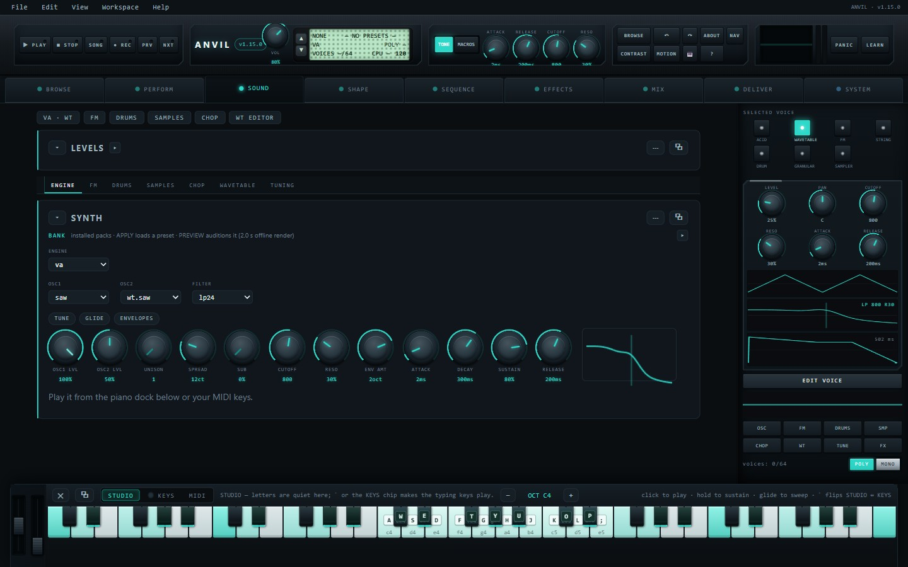
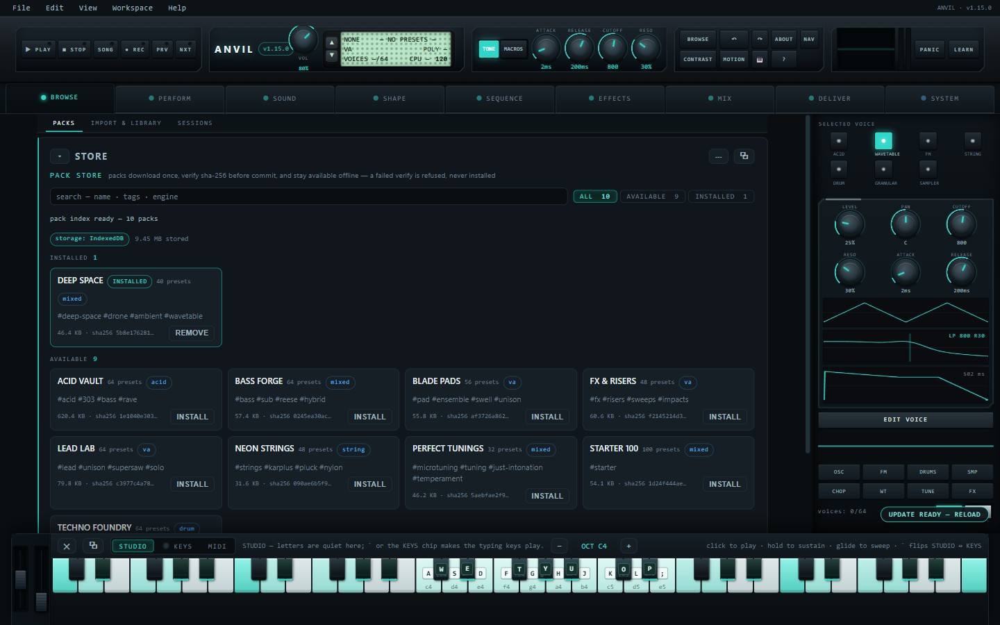
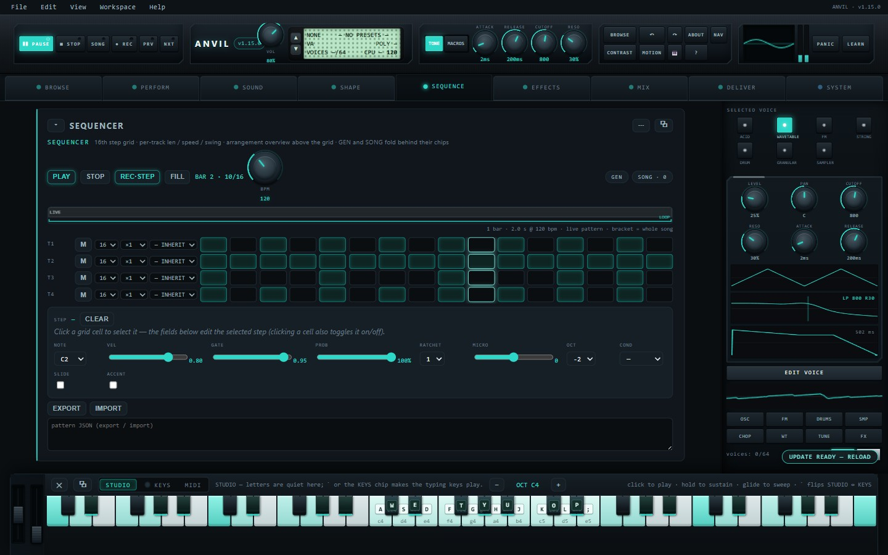

# Anvil 1.15.0 - for Windows

Anvil is a synth-and-groovebox you can actually play: acid, wavetable, FM, string, drum,
granular and sampler engines in one instrument; a native step sequencer with chains, song rows
and scenes; a seven-slot FX rack with a drag-to-modulate matrix; a tuning studio (12 scales,
Scala .scl/.kbm import, live MTS SysEx receive); an import pipeline and a searchable library for
your own sounds; a store with 10 packs / 580 presets; and a recording desk that exports WAV,
stems, MIDI and Song Bundles. It is the same app as the free in-browser version at
moddys.net/anvil - this is that app in its own window, by itself. It is a MODDYS Foundry
instrument and a sibling of Pattern Forge.

This release is the instrument rebuilt, not a patch. If you tried the beta in October, this is
a different instrument to look at and a much better one to work in.

A look at the Windows build:

## What's new

**A new chassis.** Nine pages in signal order - browse, perform, sound, shape, sequence,
effects, mix, deliver, system - on a proper instrument frame: a band across the top, the page
tabs, the work surface, the voice inspector down the right and the keys at the bottom. The
inspector is live: the kind keys switch the engine, the core pots ride the real parameter paths,
and POLY/MONO is a real per-channel allocator now instead of a label.

**Every page rebuilt around the work.** Each card leads with the surface you actually play: the
pads, the grid, the piano roll, the mixer strips. The reference material - module knobs, routing
tables, glue and master chain, auto-mix, A/B - folds behind a chip and costs one line when it is
closed. Nothing folded is a control you need mid-performance: the FILL toggle moved out of the
folded generators and onto the transport row for exactly that reason.

**Six new screens, drawn from the engine's own numbers.** The filter response inset in the
engine card is painted from the same biquad coefficients the audio path runs. The envelopes
overlay draws the two real envelopes. Every FX strip carries its module's screen - drive
transfer curve, compressor in/out, delay taps, reverb and convolution tails, the mod LFO. The
mixer has a master EQ curve you can drag, and every strip carries a waveform of its source. The
modulation matrix is a routing graph now: sources on the left, six destinations on the right,
one line per slot, and you can drag a chip straight onto pitch and pan. The sequencer draws the
song as bars above the grid, with captured scenes you can recall from the strip.

**Two new controls, used where they belong.** Two-choice switches (DELIVER's bit depth, CODE's
module kind) are a pair of keys over the same hidden value, and number fields (MIX compressor
fade, studio offset) are real inputs flanked by steppers - one click is one step, and a clamp
does not fire an event it did not make. Knobs, faders and the rest of the vocabulary are
unchanged.

**Accessibility, finished rather than promised.** Every disclosure publishes its state, every
one of the 44 tabs resolves its panel and names it back, the FM operator keys are a real tab set
(one tab stop, arrows walk the six operators), and the focus order is recorded per page and
checked with real key presses on every run.

**No first-second crackle.** The engine now warms all 64 voices silently at start-up, so the
first chord you play after opening the app runs on warm code instead of stuttering through the
one-time cost of building the voice pool. On the stress rig this removed every dropped audio
buffer in the first thirty seconds - it used to be the only place drops ever happened.

## In this release

- Anvil-1.15.0-Setup.exe - the installer. Per-user (no admin prompt), Start Menu entry and
  desktop shortcut, upgrades install straight over the top, clean uninstall from Add/Remove.
  It is not code-signed yet, so SmartScreen will say it hasn't seen this app before - More
  info, then Run anyway.
- Anvil-1.15.0-Setup.exe.zip - the same installer as a zip, byte for byte: the exact file
  moddys.net/moddys-downloads.html serves.
- Anvil-1.15.0-source.zip - the corresponding source for this build (AGPL-3.0-or-later): the
  app build frozen into the installer, the src/ tree it is assembled from, the Electron shell,
  the installer script, and the build and verification tools.

## Good to know

- Windows 10/11, 64-bit. Everything the app needs is inside the install - the engine, all ten
  packs, the help and the walkthrough - so it opens and plays with no network at all. The only
  online parts are the family bridges (importing a Resonance Studio pack, the World Radio
  hand-off), and those go out only when you click them.
- Your projects, sessions, takes, installed packs and settings live in %APPDATA%\Anvil. The
  installer never touches that folder; the uninstaller keeps it by default and asks before
  deleting anything - installing again picks up where you left off. Nothing is sent anywhere.
- Verified on this exact payload: the app's own suites ran green on the frozen build (28 suites,
  hub 68 checks, fit 49, accessibility 37; bench, alias and stress clean), the desktop suite
  drives the installed program (32 checks), and a silent install -> upgrade-over install ->
  uninstall journey (28 checks) leaves your data intact. The build inside the installer is
  byte-identical to the one live at moddys.net/anvil.
- If something breaks, tell me: modtech@gmail.com.

## sha256

  e3a16a2259dd06ae812e509145f4cc77f294689510c38d400310edda818db864  Anvil-1.15.0-Setup.exe
      100,936,871 bytes

  6f8dda610927607eb92e1dbba39ce5217b23b7a90db56e9a381cf475e6a17c57  Anvil-1.15.0-Setup.exe.zip
      100,457,994 bytes

  c083920c2f99440289772fc2f648dcf22fcc147c0c7f99b0fad02246118762de  Anvil-1.15.0-source.zip
      45,750,275 bytes

On Windows: `certutil -hashfile "Anvil-1.15.0-Setup.exe.zip" SHA256`. The exe inside unzips
to the first hash, which is also the installer attached to this release. The installer carries
app build `e8aaee89`, the same build that is live at moddys.net/anvil.

The download page is also https://moddys.net/moddys-downloads.html.

Cheers Moddy !
